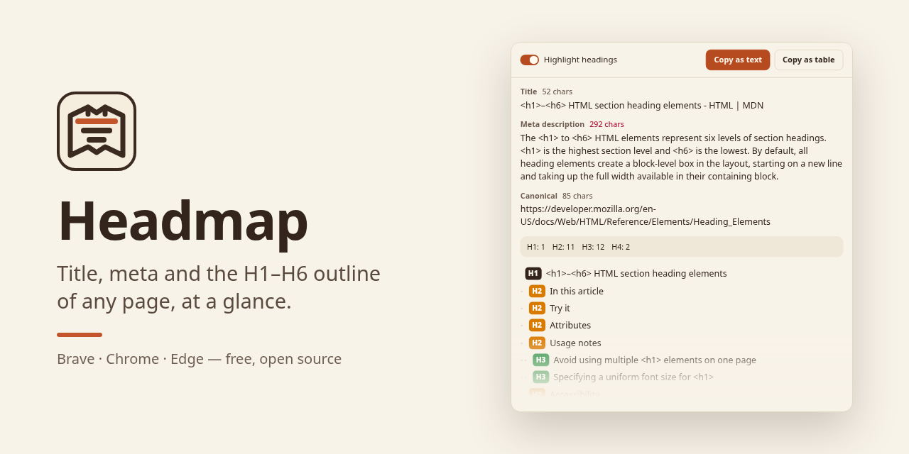
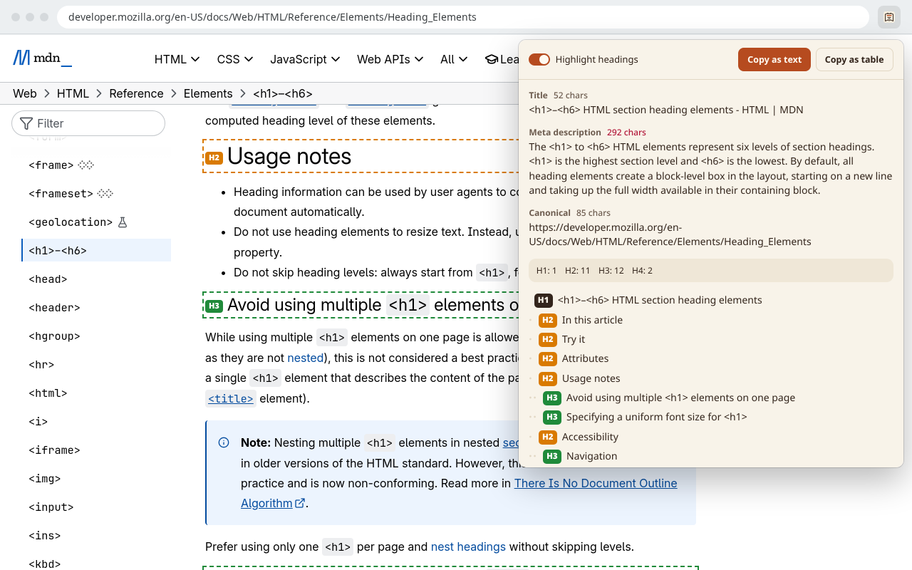
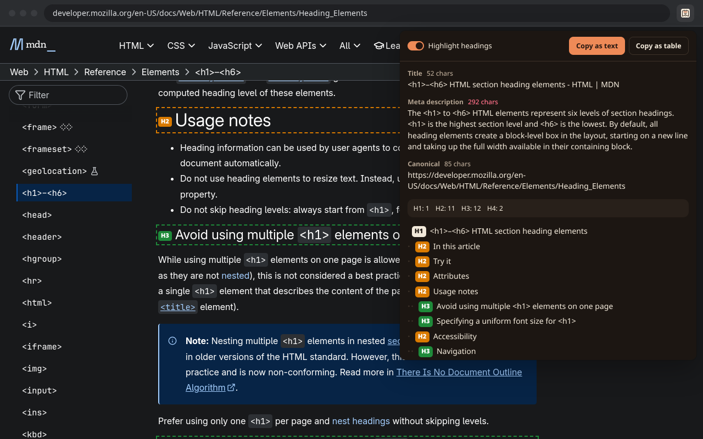

<p align="center"></p>

<h1 align="center">Headmap</h1>

<p align="center">
See a page's title, meta description, canonical, robots and H1–H6 outline at a glance.<br>
A small extension for Brave, Chrome and Edge.
</p>

<p align="center">
<a href="https://github.com/YakupEmreYerli/headmap/actions/workflows/check.yml"></a>
<a href="LICENSE"></a>

</p>

<p align="center"><a href="README.tr.md">Türkçe</a></p>



## Features

- **Page basics.** Title and meta description with character counts; the count turns red past 60 and 160
  characters. The canonical URL, and the robots meta when the page sets one.
- **Heading outline.** Every H1–H6 in document order, indented by level, with a count per level.
- **Warnings.** No H1, more than one H1, a skipped level (H2 straight to H4) and headings that exist in the
  markup but are not visible on screen.
- **Jump to a heading.** Click a line in the outline and the page scrolls to it and flashes it.
- **Highlight headings.** Outlines every heading on the page and labels it with its level.
- **Copy as text.** URL, title, meta and the indented outline as plain text, for a doc or a chat.
- **Copy as table.** The same data as tab-separated rows; Excel and Google Sheets split it into columns.
- **Light and dark.** Follows the system theme.
- **English and Turkish.** Follows the browser language.





## Privacy

Headmap asks for two permissions, `activeTab` and `scripting`. It reads the current tab only when you open
the popup, keeps nothing and sends nothing: there is no background script, no storage and no network
request. Browser pages (`chrome://`, `brave://`) and extension stores can't be read, by browser rule.

## Install

Headmap is not in the Chrome Web Store yet. To load it from source:

1. Download or clone this repository.
2. Open `chrome://extensions` (Brave: `brave://extensions`, Edge: `edge://extensions`).
3. Turn on **Developer mode**.
4. Click **Load unpacked** and pick the repository folder.
5. Pin Headmap from the extensions menu and click it on any page.

## Project layout

| Path | What it is |
| --- | --- |
| `manifest.json` | Manifest V3; no background worker |
| `popup.html`, `popup.css`, `popup.js` | The whole extension: reads the tab, renders, copies |
| `_locales/` | English and Turkish strings |
| `icons/` | PNG icons; `icons/src/` holds one SVG per size |
| `tools/build-icons.sh` | Renders the SVGs to PNG (needs `rsvg-convert`) |
| `tools/check.mjs` | Static checks that CI runs: icons, locale keys, description length |
| `docs/` | Screenshots and the social preview |

## Development

There is no build step. Edit the files, then press the reload button on the extension card.

```sh
node tools/check.mjs        # the same checks CI runs
./tools/build-icons.sh      # after editing icons/src/*.svg
```

The small icons are drawn separately rather than scaled down: `icon-16.svg` is placed pixel by pixel and
drops the fold lines so it stays sharp in the toolbar.

Opening `popup.html?tab=<tabId>` as a normal page renders the report for that tab, which is handy for
automated tests and screenshots.

## License

[MIT](LICENSE) © 2026 Yakup Emre Yerli
