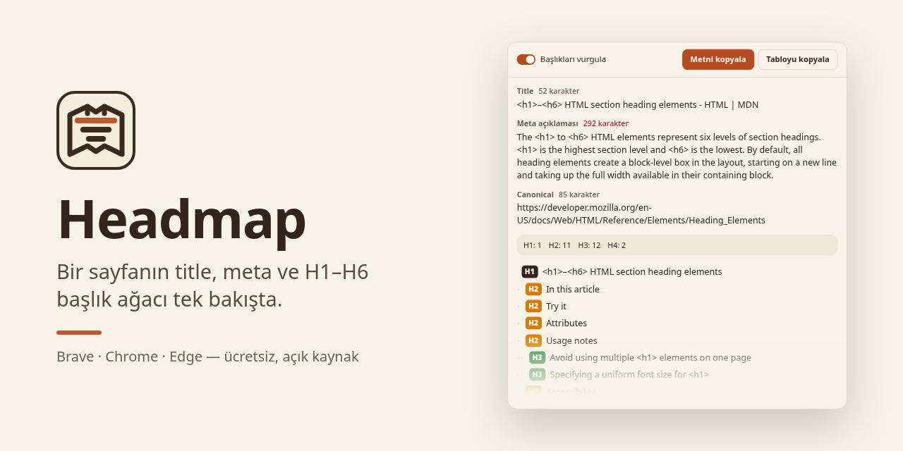

<p align="center"></p>

<h1 align="center">Headmap</h1>

<p align="center">
Bir sayfanın title, meta açıklaması, canonical, robots ve H1–H6 başlık ağacı tek bakışta.<br>
Brave, Chrome, Edge ve Firefox için küçük bir eklenti.
</p>

<p align="center"><a href="README.md">English</a></p>



## Özellikler

- **Sayfanın temeli.** Title ve meta açıklaması karakter sayısıyla; 60 ve 160 karakteri geçince sayı
  kırmızıya döner. Canonical adresi, sayfa belirtmişse robots etiketi.
- **Başlık ağacı.** Bütün H1–H6 başlıkları belge sırasıyla, seviyesine göre girintili, seviye başına sayıyla.
- **Uyarılar.** H1 yok, birden fazla H1, atlanan seviye (H2'den doğrudan H4'e) ve kodda olup ekranda
  görünmeyen başlıklar.
- **Başlığa git.** Ağaçtaki bir satıra tıklayınca sayfa o başlığa kayar ve başlık kısa bir an parlar.
- **Başlıkları vurgula.** Sayfadaki her başlığın çevresini çizer, yanına seviyesini yazar.
- **Metni kopyala.** URL, title, meta ve girintili başlık ağacı düz metin olarak; bir belgeye ya da sohbete.
- **Tabloyu kopyala.** Aynı bilgi sekmeyle ayrılmış satırlar olarak; Excel ve Google E-Tablolar sütunlara böler.
- **Açık ve koyu tema.** Sistem temasını izler.
- **Türkçe ve İngilizce.** Tarayıcının dilini izler.


## Gizlilik

Headmap iki izin ister: `activeTab` ve `scripting`. Açık sekmeyi yalnızca açılır pencereyi açtığında okur,
hiçbir şey saklamaz, hiçbir yere göndermez: arka plan betiği, depolama ya da ağ isteği yok. Tarayıcının
kendi sayfaları (`chrome://`, `brave://`, `about:`) ve eklenti mağazaları tarayıcı kuralı gereği okunamaz.

## Kurulum

Headmap henüz Chrome Web Mağazası'nda da Firefox Eklentileri'nde de yok. Brave, Chrome ya da Edge'e kaynaktan
yüklemek için:

1. Bu depoyu indir ya da klonla.
2. `chrome://extensions` adresini aç (Brave: `brave://extensions`, Edge: `edge://extensions`).
3. **Geliştirici modu**nu aç.
4. **Paketlenmemiş öğe yükle**'ye tıkla ve depo klasörünü seç.
5. Eklentiler menüsünden Headmap'i sabitle, herhangi bir sayfada tıkla.

Firefox (140 ya da sonrası):

1. Bu depoyu indir ya da klonla.
2. `about:debugging#/runtime/this-firefox` adresini aç.
3. **Geçici Eklenti Yükle…**'ye tıkla ve depo klasöründeki `manifest.json` dosyasını seç.
4. Eklentiler menüsünden Headmap'i sabitle, herhangi bir sayfada tıkla.

Firefox geçici eklentiyi kapanınca kaldırır; yeniden başlattıktan sonra tekrar yükle.

## Geliştirme

Derleme adımı yok. Dosyaları düzenle, eklenti kartındaki yenile düğmesine bas.

```sh
node tools/check.mjs        # CI'ın çalıştırdığı denetimler
./tools/build-icons.sh      # icons/src/*.svg düzenlendikten sonra
```

Proje yapısı ve ayrıntılar için [İngilizce README](README.md#project-layout).

## Lisans

[MIT](LICENSE) © 2026 Yakup Emre Yerli
